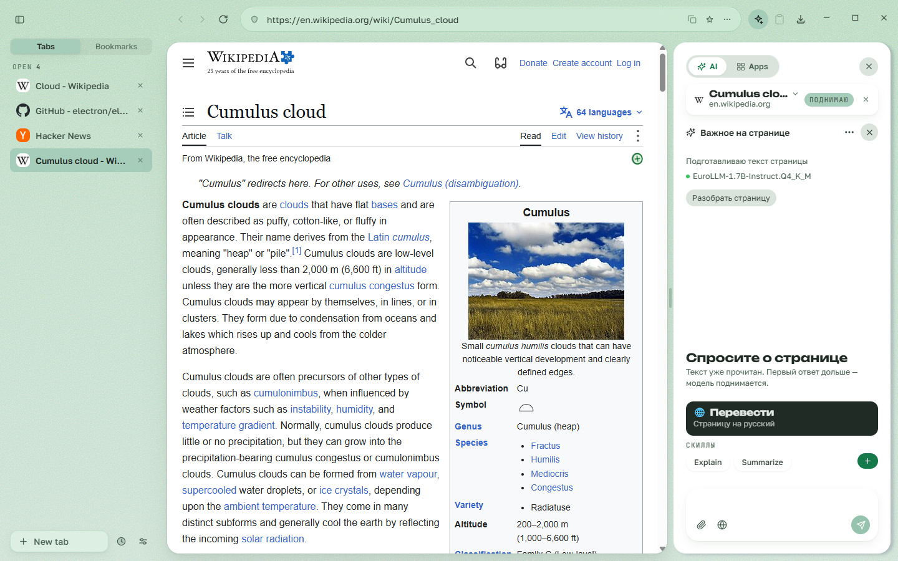
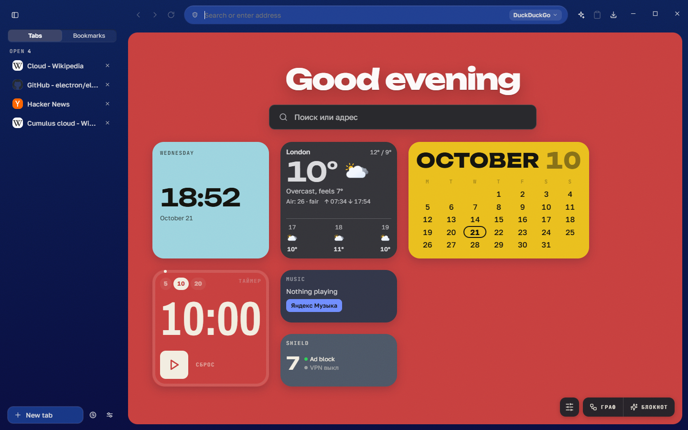
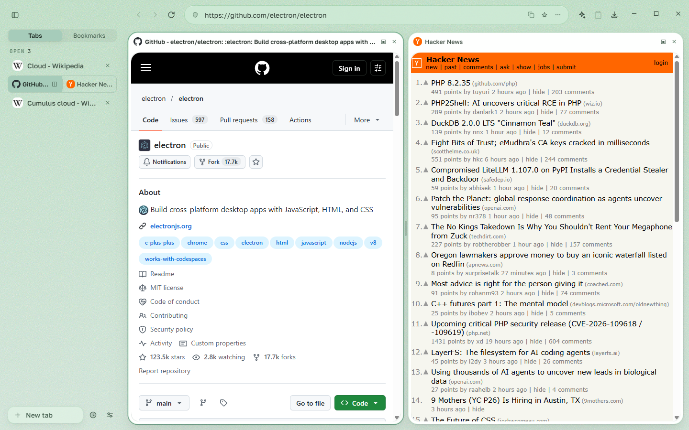
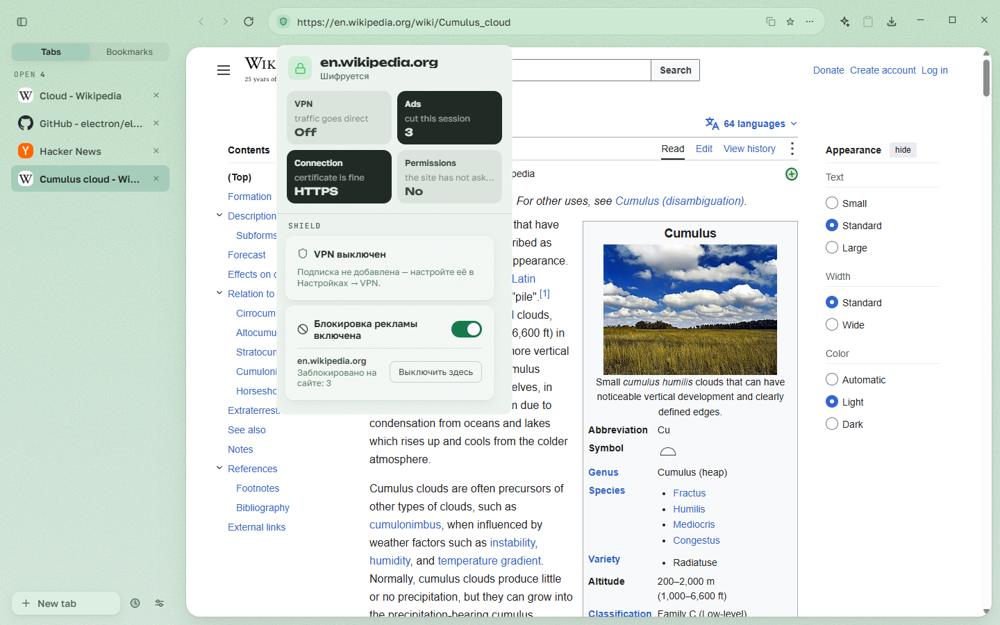
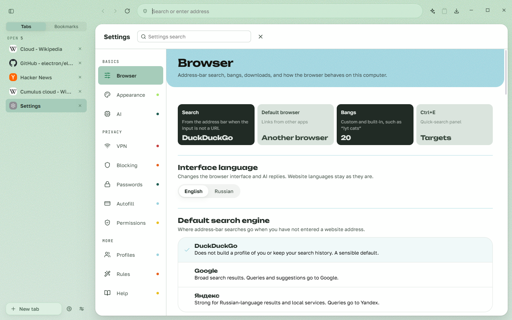

<div align="center">


# Oblako

**A private browser for Windows where AI works on your side**

Ad blocking and VPN out of the box, a local language model on top of your tabs and history, and AI that suggests — while you press and confirm

**English** · [Русский](README.ru.md)

[](LICENSE)


[](https://github.com/radiypoloniy/oblachka-browser/releases)



</div>

## Why

Chrome belongs to an ad company, Edge is a storefront for Microsoft services, and the new “AI browsers” send your mail and chats to someone else’s server so the assistant can help. Oblako takes the other road:

- **the model runs on your machine** — translation, recap, search across tabs and history never leave it;
- **AI proposes, you decide** — grouping, rules and edits arrive as a card with a button, never as an action taken for you;
- **privacy is built, not promised** — ad blocking, a VPN with a kill switch, encrypted passwords and zero telemetry.

Cloud features exist too, and they are named as such: web search through SearXNG and fact-check through Gemini. They get only the query you typed — never your tabs, history or drafts — and switch off in Settings.

## Features

**Browser core**
- **Vertical tabs** with drag-and-drop, groups, pinning and sleeping background tabs.
- **Split view**: two pages side by side, with a draggable divider.
- **Equal windows**: each has its own new-tab desktop, AI panel and tools; a tab moves between windows alive — back history, scroll and typed text stay.
- **Every window restores** after a restart; Ctrl+Shift+T brings back a closed tab or a whole window.
- Incognito on an isolated in-memory session, fullscreen video and picture-in-picture, a window snapshot with markup (Ctrl+Shift+S), human-readable error pages.

**Privacy and protection**
- **Ad blocking** on the Ghostery engine, including YouTube video ads, with lists updated in the background.
- **Built-in VPN** on Xray-core: subscription import, a server list with flags, a fail-closed kill switch — if the tunnel dies, traffic stops instead of leaking. Both live in the card under the shield in the address bar.
- **Password manager**: AES-256-GCM over the Windows key store, clickless autofill, a generator, showing a password only through Windows Hello.
- Address and bank-card autofill (card number behind Windows Hello, CVC never stored), site permissions with “allow / deny / forget”.
- No telemetry, fonts bundled locally — the browser does not even tell Google that it started.

**Local AI**
- **AI panel** next to any page: ask about the page in your own words, or chat with no page at all; context presets, attached photos and documents.
- **Page translation** on Bergamot (CPU, no GPU needed) with a Qwen fallback.
- Finding a tab by meaning, meaning-based Ctrl+F that highlights the place on the page, “what I did today” from your history, “you have already read this”.
- **Tidy up**: AI groups your tabs into a proposal you accept or undo in one move.
- The model is downloaded from the UI for your actual GPU — or not at all: without it the browser works in full and the AI stays quiet.

**Larger AI surfaces**
- **Notebook** in the NotebookLM vein: sources from links and files (PDF, DOCX, TXT, MD, CSV), a chat grounded on them, and a Studio — recap, mind map, infographic, quiz, article page.
- **Graph workspace**: you draw the plan as linked nodes, the model does one narrow step per node.
- Product comparison across open shop tabs and price tracking with notifications.
- Your own cloud models by API key, routed by role, and auto-discovery of local Ollama and LM Studio servers.

**The browser as a tool for your AI client**
- A built-in **MCP server** lets Claude Desktop, Cursor or Claude Code read tabs and history with the consent you give when connecting. Every change is confirmed by a card in the browser itself. No clicking or form filling on pages.

**Everyday life**
- A **new-tab desktop** with widgets — weather, rates, crypto, clock, timer, day recap — and a free tile layout.
- Light and dark themes with palettes, omnibox bangs, a calculator right in the address bar.
- **Moving in** from Chrome, Edge, Brave, Opera, Vivaldi, Yandex Browser and Firefox: bookmarks, history and passwords.
- Auto-update and an English or Russian interface.

<table>
<tr>
<td align="center"><br><sub>New-tab desktop in the dark theme</sub></td>
<td align="center"><br><sub>Split view</sub></td>
</tr>
<tr>
<td align="center"><br><sub>Ad blocking and VPN under the shield</sub></td>
<td align="center"><br><sub>Settings</sub></td>
</tr>
</table>

## Installation

1. Download `Oblako-Setup-x.y.z.exe` from [Releases](https://github.com/radiypoloniy/oblachka-browser/releases/latest) — or the ZIP if you do not want to install.
2. Run it. The build is not yet code-signed, so Windows SmartScreen may warn you: “More info” → “Run anyway”.
3. On first launch the browser offers to bring over bookmarks, history and passwords from the browser you used before. You can skip it.

Updates arrive by themselves; you are asked before restarting.

**Requirements:** Windows 10 or 11, x64. Local AI is comfortable from 6–8 GB of video memory; the model catalog measures your hardware and does not offer a download that would not run.

## Privacy

- **No telemetry.** The browser sends nothing about you anywhere.
- **Your profile stays on your computer**: `%APPDATA%\oblako-browser\`. Passwords and keys are encrypted with the Windows key store (DPAPI) and never written as plain text or to logs.
- **Local where it is about you.** Everything that reads your pages, tabs and history runs on the local model.
- **Cloud only by your choice and named as such**: web search, fact-check and your own cloud models receive only what you sent them. Model weights and filter lists are downloaded only when you choose to.

## Building from source

You need **Node.js 22.6+** and Windows x64.

```bash
npm install     # dependencies, better-sqlite3 rebuilt for Electron, Bergamot patch
npm run dev     # Vite + Electron with hot reload
npm run build   # production build
npm test        # every pure-logic and contract check
npm run dist    # installer and ZIP in release/
```

Details — [DEVELOPMENT.md](DEVELOPMENT.md); what must stay green before a commit — [CONTRIBUTING.md](CONTRIBUTING.md).

## Repository layout

```
electron/   main process: windows, tabs, VPN, ad blocking, AI, MCP server, IPC handlers
src/        interface on React: toolbar, sidebar, new-tab desktop, settings, AI panel
shared/     pure logic and the typed IPC contract, covered by checks
scripts/    checks (npm test), live stands (npm run drive), utilities
docs/       architecture by area, release notes
```

## Documentation

- [docs/pitch.md](docs/pitch.md) — the longer case: the problem, the answer, the business model and the honest risks.
- [ROADMAP.md](ROADMAP.md) — what is done, what is next, and what will not be here.
- [DEVELOPMENT.md](DEVELOPMENT.md) · [CONTRIBUTING.md](CONTRIBUTING.md) · [SECURITY.md](SECURITY.md)
- [docs/](docs/README.md) — architecture by area and [release notes](docs/releases/).

Most technical docs are in Russian.

## License

[Apache License 2.0](LICENSE), with the required third-party notices in [NOTICE](NOTICE). Language-model weights and filter lists are not in the repository and ship under their own licenses.
