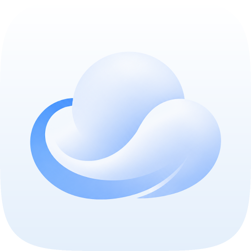
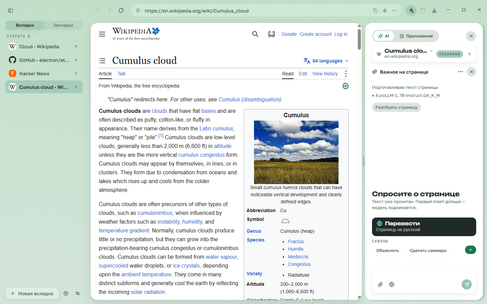
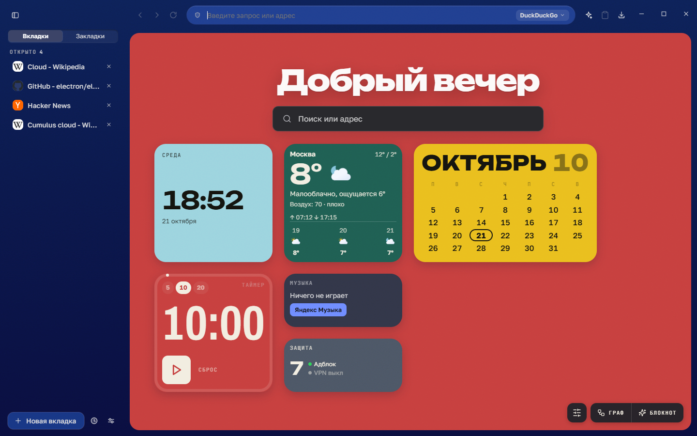
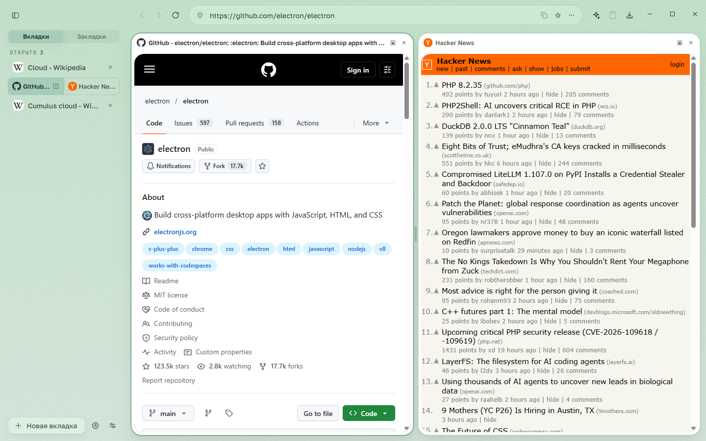
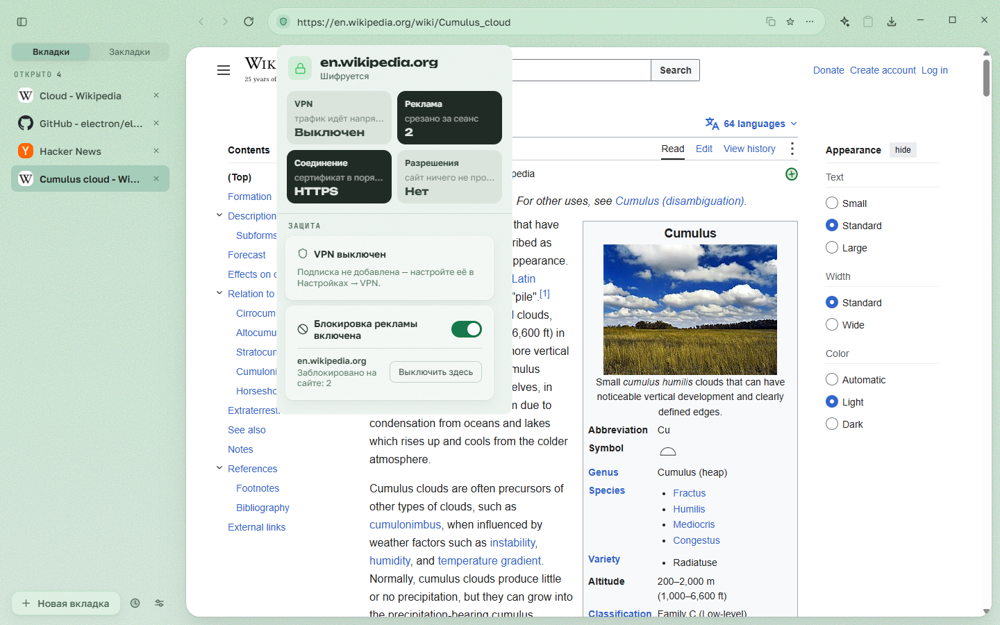
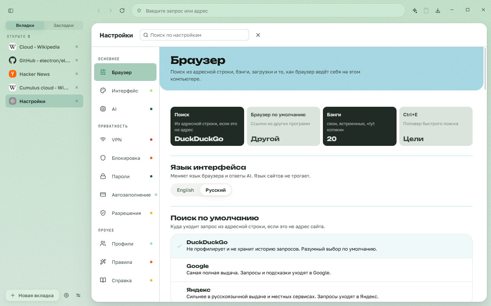

<div align="center">



# Oblako

**Приватный браузер для Windows, в котором ИИ работает на вашей стороне**

Блокировка рекламы и VPN из коробки, локальная языковая модель поверх ваших вкладок и истории и ИИ, который предлагает, а нажимаете и подтверждаете вы

[English](README.md) · **Русский**

[](LICENSE)


[](https://github.com/radiypoloniy/oblachka-browser/releases)



</div>

## Зачем

Chrome принадлежит рекламной компании, Edge — витрина сервисов Microsoft, а новые «ИИ-браузеры» отправляют вашу почту и переписку на чужой сервер, чтобы ассистент мог помочь. Oblako идёт другой дорогой:

- **модель работает на вашей машине** — перевод, пересказ, поиск по вкладкам и истории не покидают её;
- **ИИ предлагает, решаете вы** — группировка, правила и правки приходят карточкой с кнопкой, а не действием за вас;
- **приватность сделана, а не обещана** — блокировка рекламы, VPN с kill switch, зашифрованные пароли и ноль телеметрии.

Облачные функции тоже есть, и они названы прямо: веб-поиск через SearXNG и фактчек через Gemini. Они получают только набранный вами запрос — ни вкладок, ни истории, ни черновиков — и выключаются в настройках.

## Возможности

**Ядро браузера**
- **Вертикальные вкладки** с перетаскиванием, группами, закрепом и усыплением фоновых.
- **Split view**: две страницы рядом, разделитель двигается.
- **Равноправные окна**: в каждом свой рабочий стол новой вкладки, AI-панель и инструменты; вкладка переезжает между окнами живой — с историей «назад», прокруткой и набранным текстом.
- **Все окна восстанавливаются** после перезапуска; Ctrl+Shift+T возвращает закрытую вкладку или целое окно.
- Инкогнито на изолированной сессии в памяти, полноэкранное видео и «картинка в картинке», снимок окна с разметкой (Ctrl+Shift+S), понятные страницы ошибок.

**Приватность и защита**
- **Блокировка рекламы** на движке Ghostery, включая рекламу в видео YouTube; списки обновляются в фоне.
- **Встроенный VPN** на Xray-core: импорт подписки, список серверов с флагами, fail-closed kill switch — упал туннель, трафик встаёт, а не утекает мимо. Оба живут в карточке под щитом в адресной строке.
- **Менеджер паролей**: AES-256-GCM поверх хранилища ключей Windows, автозаполнение без кликов, генератор, показ пароля только через Windows Hello.
- Автозаполнение адресов и банковских карт (номер — под Windows Hello, CVC не хранится), разрешения сайтов «разрешить / запретить / забыть».
- Никакой телеметрии, шрифты вшиты локально — браузер не сообщает Google даже о своём запуске.

**Локальный ИИ**
- **AI-панель** рядом с любой страницей: спросите о странице своими словами или поговорите без страницы; наборы контекста, прикреплённые фото и документы.
- **Перевод страниц** на Bergamot (процессор, видеокарта не нужна) с запасным переводом через Qwen.
- Поиск вкладки по смыслу, смысловой Ctrl+F, который подсвечивает место на странице, «что я сделал сегодня» по истории, «вы это уже читали».
- **«Навести порядок»**: ИИ раскладывает вкладки по группам предложением, которое принимается или откатывается одним движением.
- Модель скачивается из интерфейса под вашу видеокарту — или не скачивается вовсе: без неё браузер работает полностью, а ИИ просто молчит.

**Большие AI-поверхности**
- **Блокнот** в духе NotebookLM: источники из ссылок и файлов (PDF, DOCX, TXT, MD, CSV), чат по ним и «Студия» — пересказ, майндкарта, инфографика, квиз, страница-статья.
- **Граф**: вы рисуете план связанными узлами, модель делает по одному узкому шагу на узел.
- Сравнение товаров по открытым вкладкам магазинов и отслеживание цен с уведомлениями.
- Свои облачные модели по ключу с маршрутом по ролям и автообнаружение локальных серверов Ollama и LM Studio.

**Браузер как инструмент для вашего ИИ-клиента**
- Встроенный **MCP-сервер** даёт Claude Desktop, Cursor или Claude Code читать вкладки и историю по согласию, данному при подключении. Любое изменение подтверждается карточкой в самом браузере. Кликов по страницам и заполнения форм нет.

**Повседневное**
- **Рабочий стол новой вкладки** с виджетами — погода, курсы, крипта, часы, таймер, итоги дня — и свободной раскладкой плиток.
- Светлая и тёмная тема с палитрами, «банги» в омнибоксе, калькулятор прямо в адресной строке.
- **Переезд** из Chrome, Edge, Brave, Opera, Vivaldi, Яндекс Браузера и Firefox: закладки, история и пароли.
- Автообновление и интерфейс на русском или английском.

<table>
<tr>
<td align="center"><br><sub>Рабочий стол новой вкладки в тёмной теме</sub></td>
<td align="center"><br><sub>Split view</sub></td>
</tr>
<tr>
<td align="center"><br><sub>Блокировка рекламы и VPN под щитом</sub></td>
<td align="center"><br><sub>Настройки</sub></td>
</tr>
</table>

## Установка

1. Скачайте `Oblako-Setup-x.y.z.exe` со страницы [релизов](https://github.com/radiypoloniy/oblachka-browser/releases/latest) — или ZIP, если не хотите устанавливать.
2. Запустите. Сборка пока не подписана сертификатом, поэтому SmartScreen может предупредить: «Подробнее» → «Выполнить в любом случае».
3. При первом запуске браузер предложит перенести закладки, историю и пароли из прежнего браузера. Это можно пропустить.

Обновления приходят сами; перед перезапуском браузер спросит.

**Требования:** Windows 10 или 11, x64. Локальным ИИ удобно пользоваться от 6–8 ГБ видеопамяти; каталог моделей меряет ваше железо и не предлагает скачать то, что не запустится.

## Конфиденциальность

- **Никакой телеметрии.** Браузер никуда не отправляет сведений о вас.
- **Профиль остаётся на вашем компьютере**: `%APPDATA%\oblako-browser\`. Пароли и ключи шифруются хранилищем Windows (DPAPI) и не пишутся ни открытым текстом, ни в логи.
- **Локально там, где речь о вас.** Всё, что читает ваши страницы, вкладки и историю, работает на локальной модели.
- **Облако — только по вашему выбору и с явной подписью**: веб-поиск, фактчек и ваши облачные модели получают только то, что вы им отправили. Веса моделей и списки фильтров скачиваются только когда вы этого захотите.

## Сборка из исходников

Нужны **Node.js 22.6+** и Windows x64.

```bash
npm install     # зависимости, пересборка better-sqlite3 под Electron, патч Bergamot
npm run dev     # Vite + Electron с горячей перезагрузкой
npm run build   # прод-сборка
npm test        # все проверки чистой логики и контракта
npm run dist    # установщик и ZIP в release/
```

Подробности — [DEVELOPMENT.md](DEVELOPMENT.md); что должно оставаться зелёным перед коммитом — [CONTRIBUTING.md](CONTRIBUTING.md).

## Структура репозитория

```
electron/   main-процесс: окна, вкладки, VPN, адблок, ИИ, MCP-сервер, обработчики IPC
src/        интерфейс на React: тулбар, сайдбар, рабочий стол, настройки, AI-панель
shared/     чистая логика и типизированный IPC-контракт под проверками
scripts/    проверки (npm test), живые стенды (npm run drive), утилиты
docs/       архитектура по областям, заметки к выпускам
```

## Документация

- [docs/pitch.ru.md](docs/pitch.ru.md) — длинный разбор: проблема, ответ, бизнес-модель и честные риски.
- [ROADMAP.md](ROADMAP.md) — что сделано, что дальше и чего здесь не будет.
- [DEVELOPMENT.md](DEVELOPMENT.md) · [CONTRIBUTING.md](CONTRIBUTING.md) · [SECURITY.md](SECURITY.md)
- [docs/](docs/README.md) — архитектура по областям и [заметки к выпускам](docs/releases/).

## Лицензия

[Apache License 2.0](LICENSE), обязательные уведомления сторонних компонентов — в [NOTICE](NOTICE). Веса языковых моделей и списки фильтров в репозиторий не входят и распространяются под своими лицензиями.
